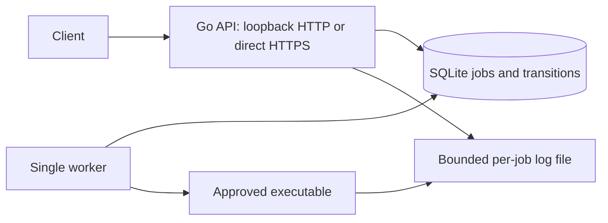

# RemoteDeck

RemoteDeck is a self-hosted task runner for Linux: submit approved tasks over HTTP,
keep their status and output, and inspect results without an interactive SSH session.
A responsive browser console supports desktop and narrow-screen layouts.

## Development status

The first local HTTP vertical slice is implemented: durable submission, sequential
execution, status/history queries and resumable raw log reads. The only task is
`system-info` (`/usr/bin/uname -a`). The Svelte console supports login, submission,
history pagination, details, incremental logs and logout. Explicitly configured
direct HTTPS supports a single operator over a private network/VPN. See
[progress](docs/progress.md) and [roadmap](docs/roadmap.md) for review status.

Implemented protections include fixed argv, a minimal environment, task deadlines,
process-group cleanup, output/queue/request bounds, private storage and a
single-instance lock. API requests require an operator bearer token or browser
session. The token is generated into `data/auth.token` on first startup (0600);
browser login exchanges it for an HttpOnly session cookie.
Restart reconciliation records uncertain running jobs as
failed without rerunning them; it does not guarantee crash containment.

## MVP architecture



The first milestone is HTTP submission → durable queue → execution → durable
status and logs → HTTP retrieval. No client-supplied executable, arguments or
working directory is accepted.

## Quick start

Build prerequisites: Linux, Go 1.25+, GCC, and Node.js 24/npm for frontend assets.
The built binary does not need Node or separate asset files. Tested locally on
Debian 13 with Go 1.27.4. Run as a non-root user; existing data directories must
be owned by that user with mode 0700. No system SQLite installation is required.

```sh
npm --prefix web ci
npm --prefix web run check
npm --prefix web run build
go build -o ./bin/remotedeck ./cmd/remotedeck
./bin/remotedeck -addr 127.0.0.1:8080 -data-dir ./data
```

The default service creates a missing data directory, listens on IPv4 loopback
and writes structured lifecycle logs to stderr. Stop it with Ctrl-C; queued jobs
remain available on the next start. For remote access, configure direct TLS using
the [HTTPS deployment instructions](docs/deployment.md#direct-https-access).
TLS-terminating reverse proxies and forwarded headers are not supported.

Open **http://127.0.0.1:8080/** on the server's browser and enter the private token
from `./data/auth.token`. The form clears it after each login attempt; it is never
saved to localStorage/sessionStorage. Sessions expire after 8 hours, logout or
service restart. Use the exact 127.0.0.1 address, not localhost. Access from another
device requires the HTTPS deployment and a trusted certificate.

Frontend output in `internal/webui/dist` is generated and ignored by Git, then
embedded into Go. **Build the frontend before Go build/test on a fresh checkout.**
The UI polls every 1.5 seconds and decodes log bytes incrementally. It displays
at most the last 200,000 characters while complete stored logs remain on disk.

## API example

After startup, use the token from the chosen data directory. The helper below
passes the header through stdin so the secret is not a curl command-line argument.
Run it from the directory containing `./data`; do not enable shell tracing.

```sh
rdcurl() {
  printf 'Authorization: Bearer %s\n' "$(cat ./data/auth.token)" |
    curl -sS --header @- "$@"
}

rdcurl http://127.0.0.1:8080/api/v1/jobs \
  -H 'Content-Type: application/json' \
  -d '{"task_type":"system-info","parameters":{}}'

# Replace JOB_ID with data.id from the response.
rdcurl http://127.0.0.1:8080/api/v1/jobs/JOB_ID
rdcurl 'http://127.0.0.1:8080/api/v1/jobs/JOB_ID/logs?offset=0&limit=65536'
rdcurl 'http://127.0.0.1:8080/api/v1/jobs?after=0&limit=20'
```

Submission returns HTTP 201 and a job ID for querying status and raw logs. See the
[API contract](docs/api.md) for exact behavior.
Missing or incorrect credentials return 401. Upgrading an existing data directory
generates a token on first startup; previously unauthenticated clients must now
send it. Jobs and logs are preserved, with no database schema change.

## Security and limitations

HTTP remains loopback-only; non-loopback listeners require a certificate, private
key and exact HTTPS origin. Cookie mutations require exact Origin and per-session
CSRF checks. HTTPS uses Secure, HttpOnly, host-prefixed cookies. The token grants full access to
the current API; it has no expiry or per-user roles. Processes running as the
service user remain trusted because they can read its private files.
Commands come from a server-side allowlist.
No arbitrary shell execution or caller-selected paths.
See [security](docs/security.md) and [deployment](docs/deployment.md).

There are no benchmark results yet. SSE, cancellation API, retries, artifacts,
and Codex integration are planned.
Per-job output is capped at 4 MiB, but total history has no retention limit.
Monitor disk space. Escaped descendants and hard-crash cleanup require future
systemd/cgroup supervision before general-purpose tasks are enabled.

## Design and development

- [Architecture and schema](docs/architecture.md)
- [Decisions](docs/decisions.md)
- [Implementation roadmap](docs/roadmap.md)
- [Reviewed steps and test evidence](docs/progress.md)

Each implementation step requires tests, a complete diff review, resolution of
blocking findings, and a focused commit before the next step begins.

```sh
go test ./...
go test -race ./...
go vet ./...
# After building ./bin/remotedeck:
cd web
npx playwright install chromium
# Browser TLS fixtures also require OpenSSL.
npm run test:e2e
```

GitHub Actions is configured for Go 1.25.x and 1.27.x on Linux. Remote CI results
are not yet available; local verification and review evidence are in progress.md.
The frontend lockfile has six high npm audit entries stemming from an unpatched
picomatch build-tool advisory. No Vite/Node server is deployed; see
[security](docs/security.md) for affected scope and the remaining limitation.
