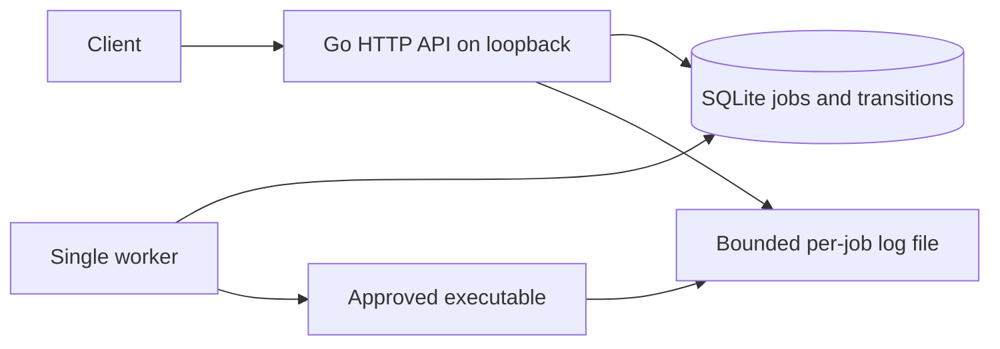

# RemoteDeck

RemoteDeck is a self-hosted task runner for Linux: submit approved tasks over HTTP,
keep their status and output, and inspect results without an interactive SSH session.
The eventual UI will support desktop and mobile browsers.

## Development status

Design baseline only. No executable, API, UI, or crash-recovery guarantee is
implemented yet. See [progress](docs/progress.md) and [roadmap](docs/roadmap.md).

## MVP architecture



The first milestone is HTTP submission → durable queue → execution → durable
status and logs → HTTP retrieval. A predefined `system-info` task will execute
`/usr/bin/uname -a` with no client-supplied command, arguments, or directory.

## Quick start

Not available until the first executable milestone passes tests and code review.
Planned build prerequisites: Linux, Go and a C compiler if the CGO SQLite driver
is approved. Nothing should be exposed publicly at this stage.

## Planned API example

```http
POST /api/v1/jobs
Content-Type: application/json

{"task_type":"system-info","parameters":{}}
```

The response will contain a job ID for querying status and raw logs. See the
[API contract](docs/api.md) for exact behavior.

## Security and limitations

Only trusted local callers are in scope for the first milestone; loopback is
mandatory until authentication exists. Commands come from a server-side allowlist.
No arbitrary shell execution, browser credentials, or caller-selected paths.
See [security](docs/security.md) and [deployment](docs/deployment.md).

There are no benchmark results or UI screenshots yet. Frontend, authentication,
SSE, cancellation API, retries, artifacts, and Codex integration are planned.

## Design and development

- [Architecture and schema](docs/architecture.md)
- [Decisions](docs/decisions.md)
- [Implementation roadmap](docs/roadmap.md)
- [Reviewed steps and test evidence](docs/progress.md)

Each implementation step requires tests, a complete diff review, resolution of
blocking findings, and a focused commit before the next step begins.
